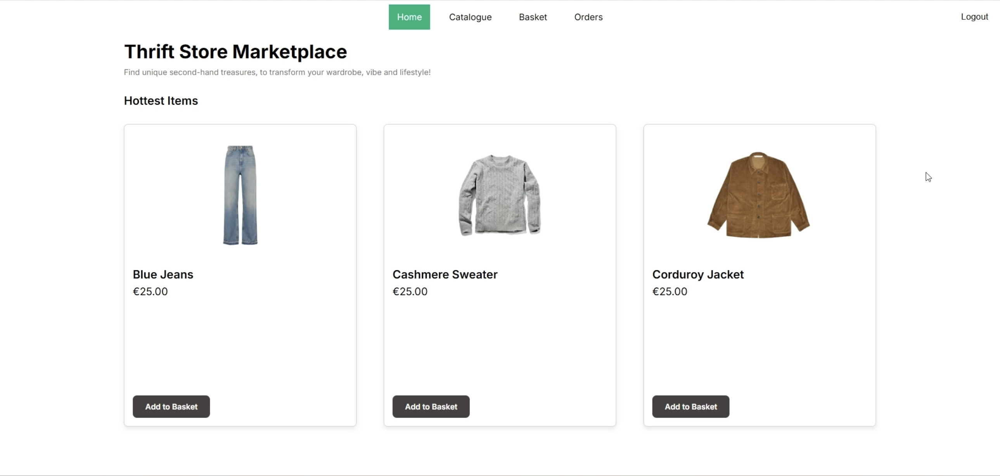
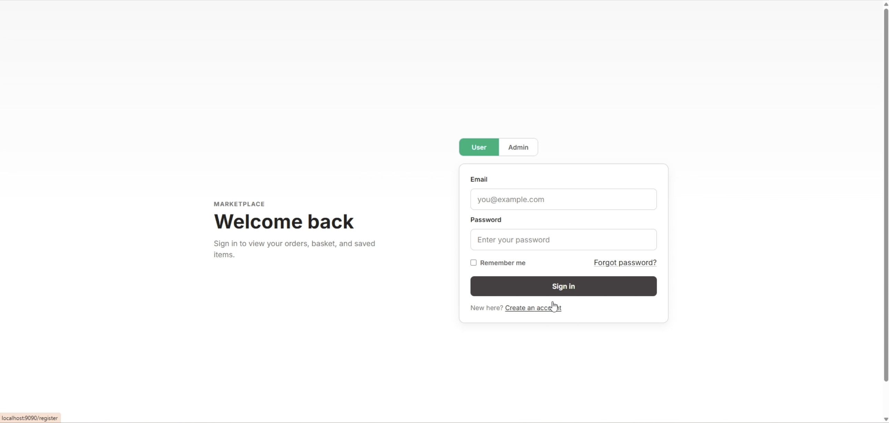
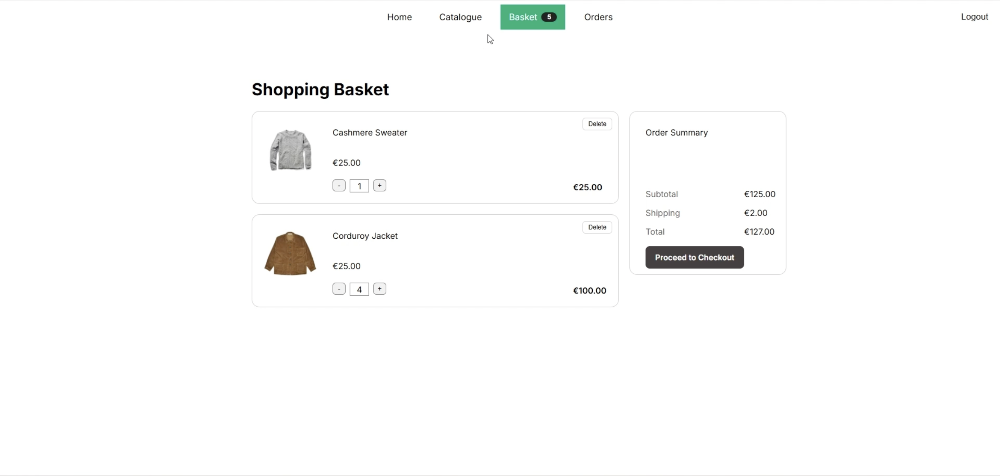
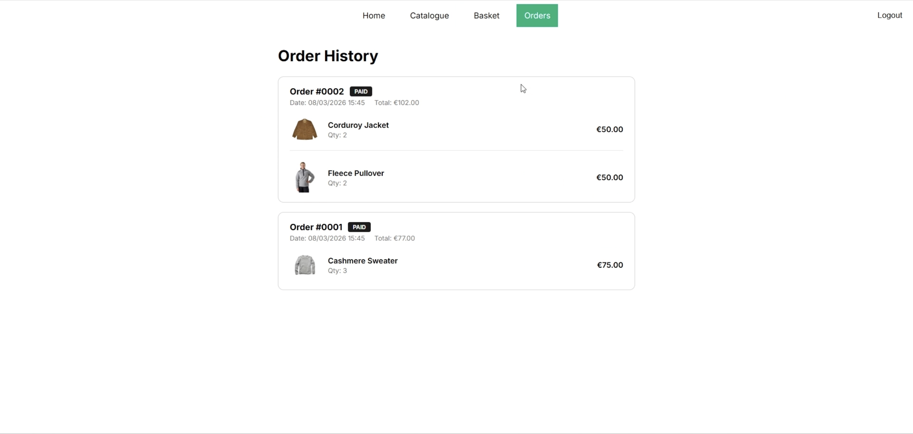
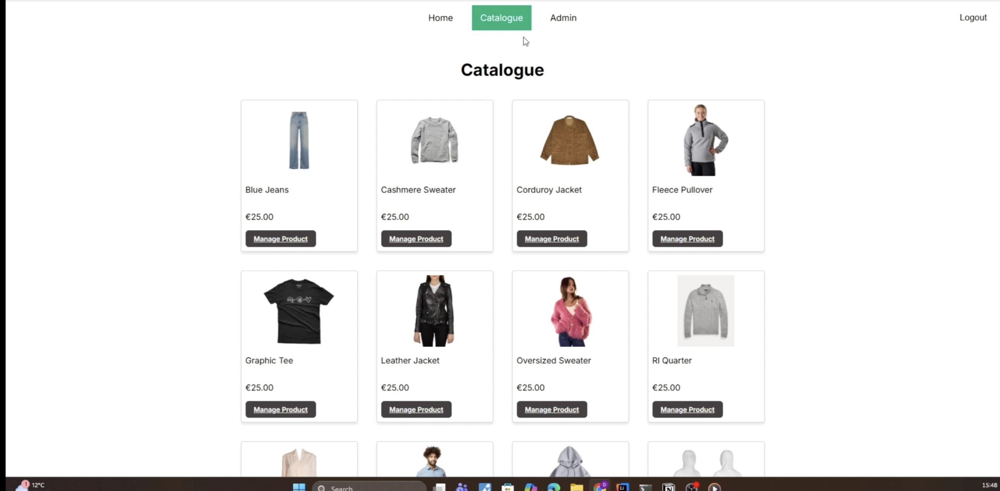
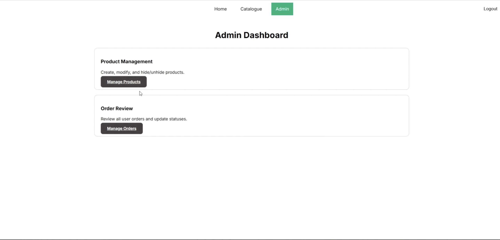

# Screenshots

### Home

The home page after sign-in, with the three hottest items.

### Sign in

Shoppers and admins use the same form. The User and Admin tabs choose the role.

### Basket

Quantities, a flat €2 shipping charge, and the order total.

### Orders

A shopper's past orders, each marked Paid once checkout completes.

### Catalogue as an admin

Admins see the same catalogue, with Manage Product on each item.

### Admin dashboard

Product management and order review.

